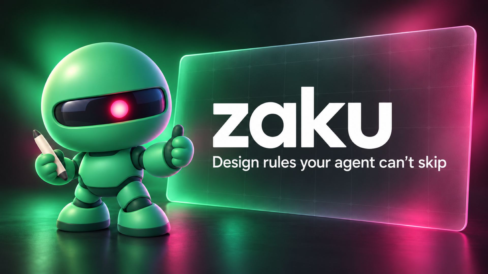

# zaku



Design rules your agent can't skip. zaku is a plugin for Claude Code and Codex: its skills carry a
product's design doctrine, and its MCP server drives a Figma plugin that checks every script an agent
runs against the design system's rules, rolling back what breaks them.

## Install

```sh
/plugin marketplace add zeroxsolutions/zaku
/plugin install zaku@zaku
```

Then import `apps/zaku-figma-plugin/manifest.json` in Figma desktop (Plugins > Development > Import
plugin from manifest) and open it in the file you draw in.

The first time, the panel says it is not paired. Ask your agent to pair with zaku: it shows an
eight-digit code, and you type that code into the panel. The code works once, for five minutes. The
panel then keeps a token and connects on its own from then on; Unpair in the panel, or the agent's
`revoke_pairing` tool, revokes it. A zaku-mcp that never issued the token, such as one a test run started,
refuses it; the panel keeps the token, tries the rest of the ports, and asks for a code only when none
admits it, then tries the same token again the next time it opens. zaku-mcp keeps only a SHA-256 hash
of each token, in `zaku/pairings.json` under your config directory (`$XDG_CONFIG_HOME`, else
`~/Library/Application Support` on macOS, `%APPDATA%` on Windows, `~/.config` elsewhere).

One process on the machine, the zaku hub, holds every panel connection. Each agent session's
zaku-mcp is a client of it: it reaches the hub on `zaku/hub.sock` in the config directory above, and
starts the hub when nothing answers there. So every session sees every paired file, a panel is paired
once, and an update reaches the hub when the first session on the new build starts. The hub stops 30
minutes after its last session ends and its last panel closes; a panel cannot start it, so a panel
opened with no hub running waits for the next session.

A file is written by one session at a time. The session whose code a panel paired with writes that
file; otherwise the first session to run a script in it does. Another session's script is refused
with `FileHeldByAnotherSession` until that session ends or 15 minutes pass after its last write; reads,
checks and screenshots are open to every session. `get_bridge_state` shows each file's writer, and the
id zaku keeps in the file, by which a session names one of two files that share a name.

The hub listens on the first free port from 7337 to 7346, or on `ZAKU_PORT` when it is set. Figma lets
the plugin reach only the ports its manifest lists, so a `ZAKU_PORT` outside that range stops zaku-mcp at
startup. The panel dials the port it last connected on, then tries the rest of the range once. If it
says Not connected, ask your agent which port the hub is on (`get_bridge_state` and
`issue_pairing_code` report it), enter it in the panel's Port field and press Connect.
`get_bridge_state` also names any other process holding a lower port of the range, such as a zaku-mcp
from before the hub, which a panel dials first.

## Workspace

An nx workspace. `AGENTS.md` lists the projects; `pnpm nx run-many -t lint typecheck build test e2e`
runs the gate.
